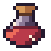

# Potion icon — 16×16 static asset

A game-ready health-potion inventory icon. This is the smallest complete example of the static
pipeline in [SKILL.md](../../SKILL.md): design model → Lua grid → one real MCP paint → export →
offline QA.



## Brief

| Field | Value |
|---|---|
| Use | Inventory / hotbar icon for a health potion |
| Canvas | 16×16, transparent |
| Read | Bottle silhouette + red liquid at 1×; works on dark and light UI |
| Palette | 11 colours, hue-shifted ramps |
| Light | Upper-left, fixed |
| Outline | 1 px plum outline (`#241A2E`), not pure black |
| Animation | None |
| Delivery | `potion.ase`, `icon.png` (1×), `icon@4x.png` |

## Design logic

- The silhouette is a round flask with a visible neck and a small cork. A wide cork directly on
  a ball reads as a jar; the 2 px glass neck plus the cork overhang makes it a potion.
- Liquid fills the lower body. The surface line is not flat: it is one pixel higher in the middle
  and one pixel lower at the edges, so it reads as a meniscus rather than a belt.
- One focal colour: the warm red liquid. The cork and glass use lower-saturation supporting
  ramps (`#4B3B57 → #8A7895 → #CFC2D2`, `#5A3524 → #A9683C → #D79A5B`).
- The outline is a dark plum, not black. The shadow side of the glass is a desaturated violet;
  the liquid shadow is a deep red. The palette shifts hue as it darkens.
- The white specular is one pixel on the upper-left glass; the two bubbles are inside the liquid
  (so they are not isolated). There is no anti-aliasing: alpha is exactly 0 or 255.

## Files

```text
potion.py          parametric design model (source of truth)
potion.lua         generated paint_grid source
build.py           starts an MCP server, paints, saves, exports, runs QA
potion.ase         editable Aseprite document (generated; repo .gitignore ignores *.ase)
icon.png           16×16 transparent PNG
icon@4x.png        64×64 nearest-neighbour preview
```

## Reproduce

From the repository root, with `ASEPRITE_PATH` pointing at Aseprite:

```bash
python skills/aseprite-pixel-art/examples/potion-icon/build.py
```

The builder starts its own stdio MCP server with scratch state under `.build/`, paints the grid
in a real Aseprite, saves `potion.ase`, exports both PNGs, and runs `pixelqa.py` on the grid and
the 1× PNG. It exits non-zero if any gate fails. `ASEPRITE_WORK_DIR` is pinned to `.build/work`
so the example never writes into the repo's session store.

## Verified QA

Measured from the delivered `icon.png`:

| Check | Result |
|---|---|
| Canvas / alpha | 16×16, alpha `{0,255}`, 0 semi-transparent pixels |
| Colours | 11 visible, no near-duplicates (≤8/channel) |
| BBox | x=1, y=1, 13×14; margins L1 T1 R2 B1 |
| Coverage | 123 opaque pixels, 0.4805 |
| Noise | 0 isolated pixels |
| Scale | 4× export keeps the exact 11-colour palette, alpha 0/255 |

```bash
python skills/aseprite-pixel-art/scripts/pixelqa.py grid \
  skills/aseprite-pixel-art/examples/potion-icon/potion.lua \
  --min-margin 1 --expect 16 16 --max-colors 12
python skills/aseprite-pixel-art/scripts/pixelqa.py frames \
  skills/aseprite-pixel-art/examples/potion-icon/icon.png \
  --min-margin 1 --max-colors 12
```

## MCP calls used

1. `apply_operations(create_sprite 16×16 rgb)` → keep `session_id`.
2. Copy `potion.lua` into the session directory; `apply_operations(paint_grid, save_sprite)`.
3. `inspect(frame=1, scale=1)` for metrics.
4. `apply_operations(export png scale=1, export png scale=4)`.
5. `pixelqa` on the actual delivered files.
6. `close_session` with `confirmed=true` after the files are outside the session.

The grid lives inside the session directory, so `paint_grid` needs no external-file
confirmation. If you use a grid from your own scratch directory instead, pass
`confirmed=true` to that batch.

## What to reuse

- A parametric or hand-authored grid beats per-pixel op calls; the entire icon is one
  `paint_grid`.
- Lock the palette before drawing; 11 colours are enough for a glass bottle with liquid.
- Check the 1× icon on both backgrounds; the white specular can disappear on a light UI, which
  is why the outline and liquid remain the primary read.
