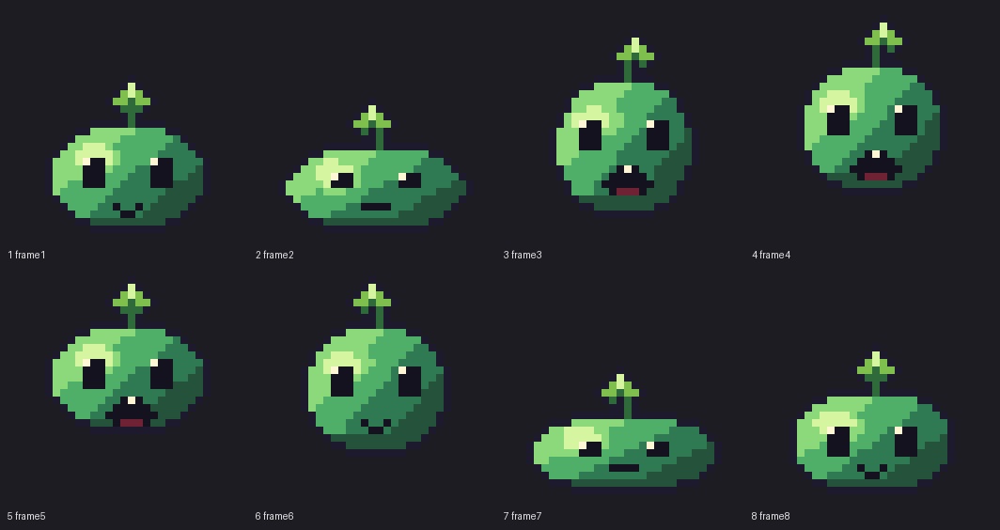

# Moss slime hop — 32×32, 8-frame loop

A complete frame-animation example: a parametric body model → eight Lua grids → one atomic MCP
build → per-frame inspect → GIF/sheet export → offline sequence QA.




## Brief

| Field | Value |
|---|---|
| Use | Small enemy / critter hop loop |
| Canvas | 32×32, transparent |
| Read | Round moss slime with a leaf sprout; face and leaf survive squash/stretch |
| Palette | 11 colours |
| Light | Upper-left, fixed in world |
| Outline | 1 px dark plum (`#1E1A2E`) |
| Loop | 8 frames, 800 ms total, tag `hop` |
| Delivery | `slime_hop.ase`, frame PNGs, 1×/4× GIF, sheet, contact sheet |

## Motion design

The body is an ellipse deformed by a width scale, a height scale, and a fixed bottom anchor.
The face is placed relative to the deformed body; the leaf is a separate silhouette that lags
the body by one frame and tilts ±1 px. The anchor is the bottom centre, so grounded frames share
the contact row while airborne frames follow an arc.

| Frame | Pose | Duration (ms) | BBox (x,y,w,h) | Opaque | Colours |
|---|---|---|---:|---:|---:|
| 1 | neutral | 140 | 5,9,22,21 | 290 | 10 |
| 2 | anticipation squash | 100 | 3,12,26,18 | 273 | 10 |
| 3 | launch stretch | 80 | 6,3,20,25 | 329 | 11 |
| 4 | rise | 80 | 6,1,20,24 | 317 | 11 |
| 5 | apex | 110 | 5,1,22,21 | 290 | 11 |
| 6 | fall | 90 | 6,1,20,24 | 317 | 10 |
| 7 | land squash | 70 | 3,13,26,17 | 263 | 10 |
| 8 | recover | 130 | 5,10,22,20 | 288 | 10 |

The mass curve is intentional: the anticipation and landing frames are the smallest, the launch
is the largest, the apex settles back to neutral volume. The mass max/min is **1.251**, inside
the 1.6 squash/stretch gate. The min margin is **1 px** (airborne leaf outline), so no frame is
clipped.

## Face and silhouette decisions

- The leaf is one broad 5 px leaf on a 2 px stem, not two one-pixel lobes. At 1× the single
  silhouette survives; the earlier two-lobe version read as antennae.
- The open mouth is a rounded **5×4 dark cavity** with a red tongue and one fang. A solid red
  rectangle at this scale read as a nose.
- The eyes are 3×4 dark shapes with one white glint; the squint frames reduce them to 3×2, and
  the landing frame flattens the mouth. The face moves with the body, so identity never morphs.
- The body shading is derived from the normalized ellipse coordinates (upper-left light,
  lower-right shadow) plus one clustered specular; the outline is a 1 px dilation of the
  silhouette. The leaf/stem are included in the silhouette so they get the same outline.

## Palette

```text
outline   #1E1A2E
deep      #24523B
shadow    #2F7A52
mid       #4FAE68
light     #8BD97A
highlight #D6F5A0
eye       #15121F
glint     #FFF6D6
mouth     #6E2233
leaf dark #2F6B3A
leaf mid  #7FBF4D
```

No near-duplicate pair; alpha is exactly 0/255; 10–11 colours per frame.

## Reproduce

From the repository root, with `ASEPRITE_PATH` pointing at Aseprite:

```bash
python skills/aseprite-pixel-art/examples/slime-hop/build.py
```

The builder:

1. regenerates `frames/*.lua` from `slime.py`;
2. starts its own stdio MCP server with `.build/work` as the work directory;
3. copies the grids into the session directory and builds the whole animation in **one atomic
   batch** (add frames → 8 paint_grids → set durations → add tag → save `.ase`);
4. inspects all eight frames and asserts alpha/noise/palette/margins/durations/tag;
5. exports frame PNGs, 1× and 4× GIFs, and the sheet;
6. runs `pixelqa.py` on grid, frames, GIF, sheet, and contact sheet;
7. closes the session with `confirmed=true` after the deliverables are safe.

## Verified QA

| Check | Result |
|---|---|
| Frames / size | 8 frames, 32×32 every frame |
| Alpha | `{0,255}`, 0 semi-transparent |
| Noise | 0 isolated pixels on all frames |
| Palette | 10–11 used colours; no near-duplicates; no palette-code drift |
| Margins | min 1 px on all sides |
| Adjacent diffs | 201, 417, 277, 200, 203, 471, 195 px |
| Loop 8→1 | 98 px (smoother than every adjacent diff; no pop) |
| Mass ratio | 1.251 (max 1.6 for squash/stretch) |
| GIF | 8 frames, durations `140,100,80,80,110,90,70,130` ms, loop |
| Sheet | 128×64, 4 columns; every cell pixel-identical to its frame PNG |

Reproduce the gates manually:

```bash
python skills/aseprite-pixel-art/scripts/pixelqa.py grid \
  skills/aseprite-pixel-art/examples/slime-hop/frames/*.lua \
  --min-margin 1 --loop --expect 32 32
python skills/aseprite-pixel-art/scripts/pixelqa.py frames \
  skills/aseprite-pixel-art/examples/slime-hop/export/frame*.png \
  --min-margin 1 --loop --max-colors 16 --max-mass-ratio 1.6
python skills/aseprite-pixel-art/scripts/pixelqa.py gif \
  skills/aseprite-pixel-art/examples/slime-hop/export/slime_hop.gif \
  --expect-frames 8 --expect-durations 140,100,80,80,110,90,70,130
python skills/aseprite-pixel-art/scripts/pixelqa.py sheet \
  skills/aseprite-pixel-art/examples/slime-hop/export/slime_hop_sheet.png \
  --cell 32x32 --columns 4 \
  --frames skills/aseprite-pixel-art/examples/slime-hop/export/frame*.png
```

## Defects found and fixed during validation

- **Top clipping:** the first apex/rise/fall frames had the leaf outline at `y=0`
  (`inspect` bbox y=0). The poses were lowered by 1–2 px; the final minimum margin is 1 px.
- **Open mouth read as a nose:** the 5×3 red rectangle was replaced by a 5×4 dark cavity with a
  red tongue and a white fang. The silhouette of the mouth, not its colour, made it read.
- **Ghosting risk:** the grid is full-frame; if a frame is repainted, `clear_canvas` must run
  first because `paint_grid` skips `.` pixels. The builder avoids repainting after the batch.
- **Loop check:** the last→first diff is 98 px, below every adjacent diff; the recovery frame
  leads back to neutral instead of duplicating it.

## Files

```text
slime.py                 parametric design model + ASCII/GIF previews in .build/
frames/*.lua             generated paint_grid sources (8)
build.py                 end-to-end MCP build + QA
slime_hop.ase            editable source (generated; repo .gitignore ignores *.ase)
export/frame1..8.png     per-frame deliverables
export/slime_hop.gif     1× loop
export/slime_hop@4x.gif  4× preview
export/slime_hop_sheet.png  4×2 sheet, 32×32 cells, no padding
export/contact.png       labeled 8× contact sheet
```

## Game handoff

- Import the sheet as 32×32 cells, 4 columns, 2 rows, 8 frames. Add 1–2 px padding if the engine
  bleeds when filtering; the example uses 0 padding to make cell QA exact.
- The `.ase` tag is `hop` (1–8); durations are in seconds in the document and milliseconds in
  the GIF.
- Set point/nearest filtering and integer scaling in the engine. The source uses no
  semi-transparency, so alpha edges are clean.
- The leaf is part of the body silhouette; if the game recolours the slime, use a separate
  layer or a hue-shift shader rather than flattening the leaf into the body colour.
